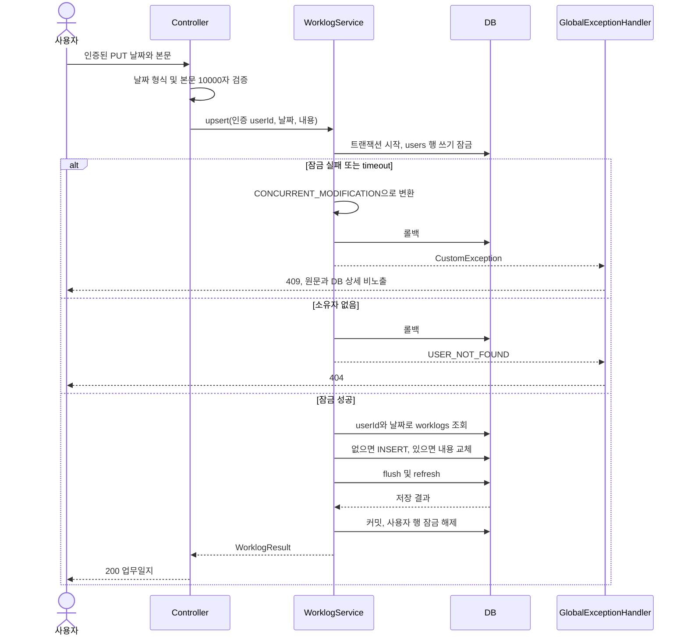

# 06-4. 업무일지 저장

## API

`PUT /api/me/worklogs/{logDate}` — FR-PSN-03, SCRUM-121. 본인 날짜별 Markdown 노트를 생성·교체한다. 업무 연결·진척률 반영은 이 흐름에 아직 없다.

## 참여자

사용자 → 인증 필터 → WorklogController → WorklogService(트랜잭션) → EntityManager(users) → WorklogRepository(worklogs) → DB → GlobalExceptionHandler(오류).

## 핵심 포인트

- 로그인 검증 뒤 서버 인증 주체의 userId만 사용한다. content 길이 검증을 통과한 요청만 서비스로 보낸다.
- users 행을 먼저 `PESSIMISTIC_WRITE`로 잠그고 worklogs를 조회한다. 잠금은 트랜잭션 종료까지 유지한다.
- 같은 사용자·날짜의 동시 첫 저장은 사용자 행 잠금으로 직렬화되고, 유일 제약이 최종 중복을 막는다.
- 같은 내용이면 dirty checking이 UPDATE를 생략한다. flush·refresh 후 DB 정밀도의 시각을 응답한다.
- 직접 JPA 잠금 timeout/획득 실패는 CustomException으로 변환되어 409를 반환한다. 트랜잭션은 롤백되고 GlobalExceptionHandler의 예상 밖 500·에러 로그 경로로 내려가지 않는다.

## 판정 순서

두 번째 동시 요청은 첫 요청의 커밋 뒤 잠금을 얻고 기존 worklog를 읽는다. 동일 내용 재전송이면 행 추가와 수정 시각 변경이 없다. 서로 다른 내용의 동시 저장은 직렬화된 순서대로 마지막 쓰기가 반영되며, 사용자에게 낙관적 version 비교를 제공하는 기능은 현재 계약에 없다.
