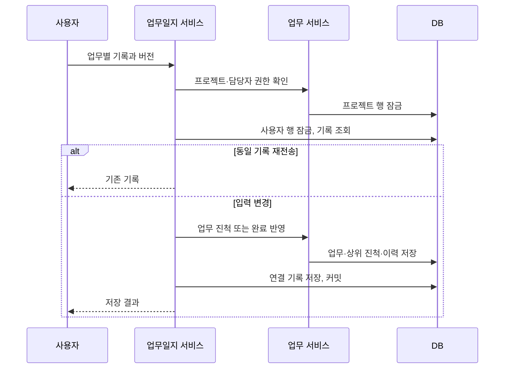

# 06-5. 업무일지 연결 업무 저장 (Sequence)

API: PUT /api/me/worklogs/{date}/tasks/{taskId}

참여자: 사용자, WorklogTaskService, WBS 권한·진척 서비스, DB.

핵심 포인트: 권한 검사 후 잠금, 프로젝트→사용자 고정 순서, 단일 트랜잭션. 실패 시 전체 롤백. PM 조회는 프로젝트에 연결된 업무별 본문만 대상으로 하며 날짜별 개인 본문을 포함하지 않는다.
