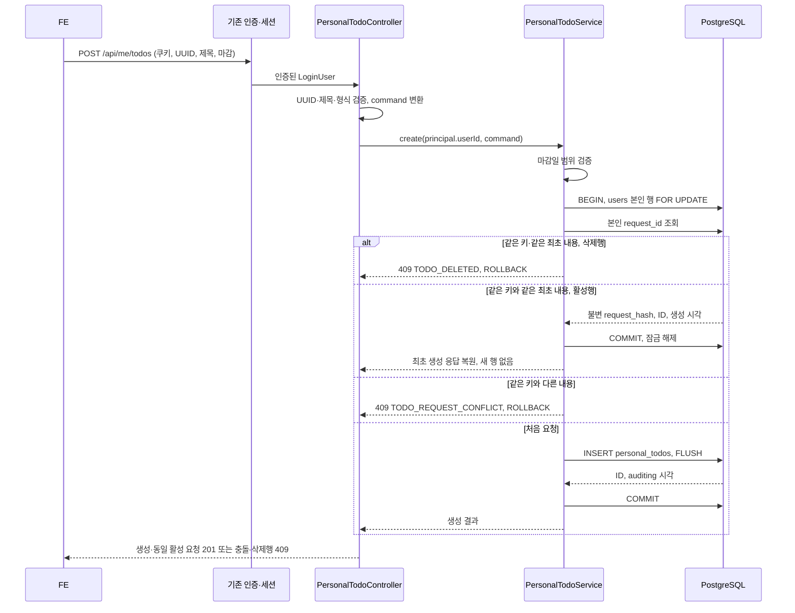
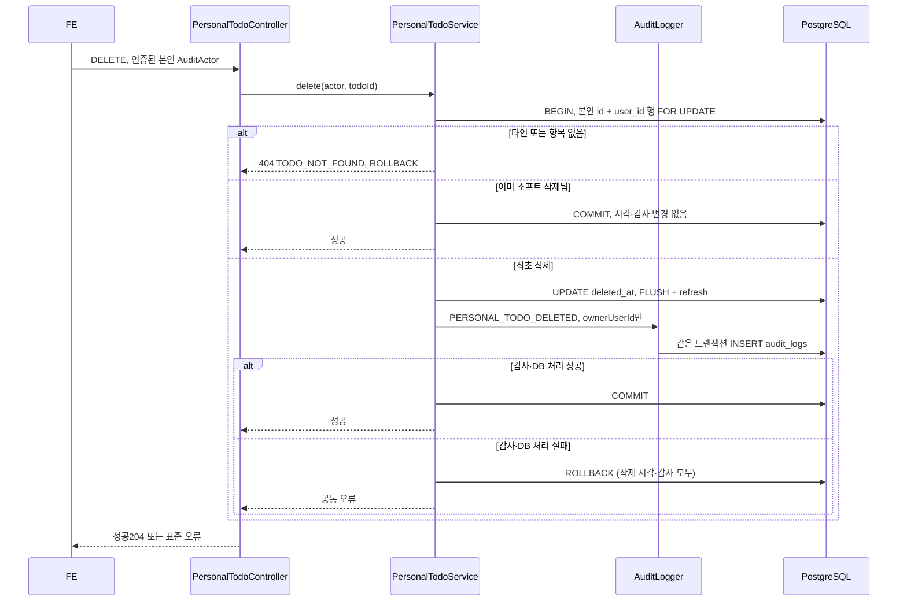

# 06. 개인 업무 (Sequence) — SCRUM-111 초안

> 상태: Draft · 담당자: 미정 · 마지막 검토일: 2026-11-22
> 기준: FR-PSN-01. 생성 멱등성·트랜잭션·잠금과 통합 조회 인가 순서가 중요해 남긴다.

## 06-1. 개인 TODO 생성·동시 재전송

- API: `POST /api/me/todos`
- 참여자: FE, 기존 JWT·세션 보안 체인, PersonalTodoController, PersonalTodoService, PostgreSQL, 주입 Clock
- 핵심 포인트: 본인 ID는 principal에서만 획득한다. `users` → `personal_todos` 잠금 순서다. 키 확인·새 행 생성은 한 트랜잭션이다. 생성 요청 내용 해시는 불변이며 제목·완료를 수정해도 최초 생성 응답 재전송 판단에 쓴다.

판정 순서: 미인증·만료 거부 → JSON 입력 검증 → 달력 날짜 범위 → 본인 사용자 행 잠금 → (본인, requestId) 조회 → 최초 내용 해시 비교 → 삭제 여부 → 동일 활성 결과·409·생성 중 결정. 삭제행은 키를 보존하고 부활시키지 않는다. 같은 사용자의 동시 재전송은 사용자 행에서 차례로 진행하며, DB 유일 키가 중복 행을 추가로 막는다. 일반 로그·감사 로그에 제목·요청 본문을 남기지 않는다. 별도 외부 네트워크 호출은 없다.

## 06-2. 개인·배정 업무 통합 조회

- API: `GET /api/me/todos`
- 참여자: FE, 기존 인증·세션 보안 체인, PersonalTodoController, TodoFeedService, ProjectAccessPolicy·ProjectVisibilityPolicy, TodoFeedRepository, PostgreSQL
- 핵심 포인트: 매 페이지에서 현재 역할·멤버·부서 범위를 재검사한다. cursor는 조회 권한을 보존하지 않는다. 개인과 업무를 한 번의 size+1 제한 UNION으로 조회한다. KST 정렬 날짜는 첫 페이지에서 결정하고 continuation에 고정한다.
- 판정 순서: 인증 → query 크기·기간 검증 → cursor 사용자·필터·형식 검증 → 현재 사용자 역할 조회 → 경영진 부서 범위 계산(해당 시) → 본인 개인 항목 + 현재 담당·멤버·공개 범위의 미완료 WBS 합치기 → 복합 키 정렬·size+1 제한 → source 포함 응답과 다음 커서 생성.
- 현재 상태가 커밋되면 다음 조회에 반영되므로 배정 복제·자동 정리 배치가 없다. UI가 1분 안에 재조회해야 표시 인수 기준을 충족한다. 완료·배정 해제·멤버 제외·시스템 관리자 승격 뒤에는 TASK가 제외된다.
- 개인은 done 양쪽 조회에서 deleted_at IS NULL만 반환한다. 기존 커서도 삭제행을 건너뛴다. dueSoonDays 기본3은 사용자 확정이며 오늘과 D+1~D+3을 별도 그룹으로 분류한다.

## 06-3. 개인 TODO 소프트 삭제·재전송

- API: `DELETE /api/me/todos/{todoId}`. 참여자: FE, 기존 인증·AuditActor 인자 공급, PersonalTodoController, PersonalTodoService, AuditLogger, PostgreSQL.
- 핵심 포인트: id+user_id로 제한한 본인 행 잠금 → 최초 삭제 여부 판정 → deleted_at 변경과 공통 감사 로그를 같은 트랜잭션에 저장. 감사 실패 시 삭제도 롤백한다. 제목·본문·requestId·hash는 감사에 남기지 않는다.

- 동시 DELETE는 같은 본인 행 잠금에서 순차 처리해 모두204, 감사1건·최초 삭제 시각 유지다. POST 같은 생성 키는 삭제행을 발견하고409로 거부한다. deleted_at·생성키를 삭제하지 않는다.
- 승인 요청 원천은 사용자가 후속 연결을 승인했다. 보존 기간·자동 물리 purge·복구는 미정이며 현재 도입하지 않는다.

## 변경 이력

| 날짜 | 내용 | 관련 |
| --- | --- | --- |
| 2026-11-21 | 개인 생성 멱등·동시 요청 잠금 순서, 통합 조회 권한 재판정 초안 | SCRUM-111 |
| 2026-11-22 | 사용자 결정 반영: 소프트 삭제·감사 원자성/재전송 부활 차단, 기본3일, 승인 원천 후속 연결 | SCRUM-111, V14 |
